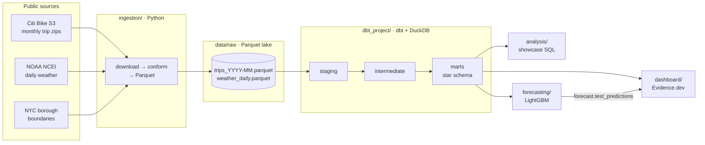
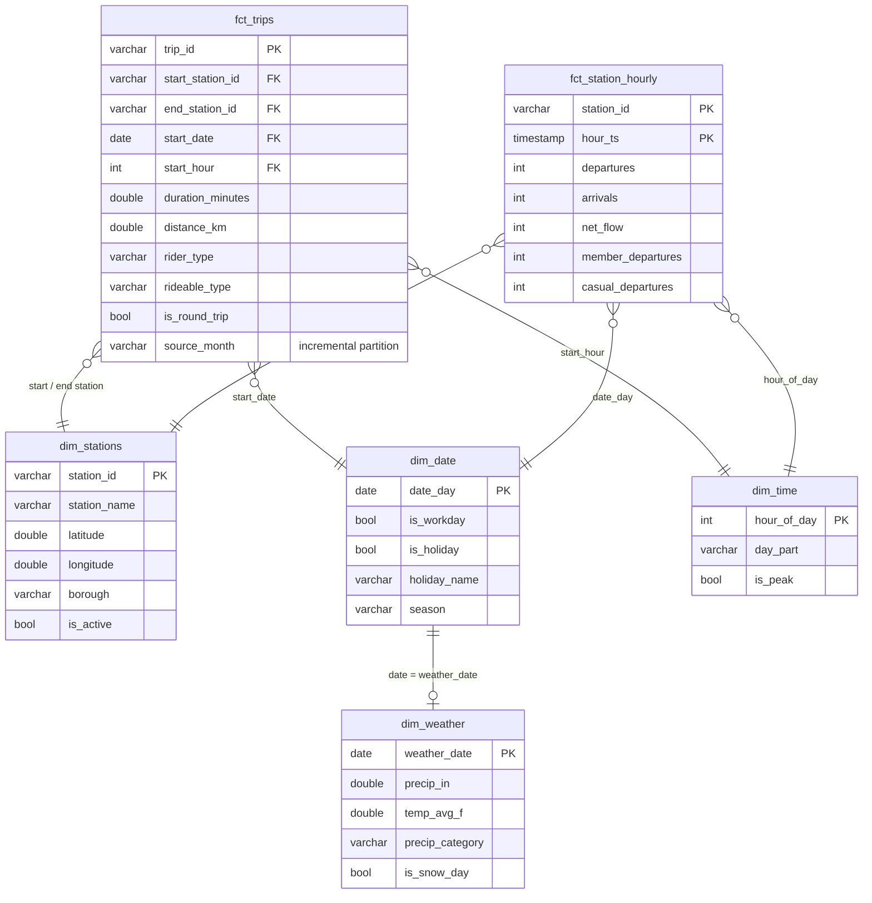

# Citi Bike NYC Analytics

An end-to-end analytics project on every Citi Bike trip in New York City: an
automated monthly ingestion pipeline, a tested dbt star schema on DuckDB,
showcase SQL, an Evidence.dev dashboard, and a LightGBM day-ahead demand
forecast built on features computed in the warehouse.

**12 months · 45.4M trips · 2,628 stations · 76 dbt tests · refreshed monthly by GitHub Actions**

## Architecture



| Layer | What it does | Where |
|---|---|---|
| Ingestion | Lists the S3 bucket, downloads only months not yet on disk, conforms old and new CSV schemas to one all-VARCHAR layout, writes one Parquet file per month. Weather from NOAA (Central Park station), borough polygons from NYC DCP. | [`ingestion/`](ingestion) |
| Scheduling | **CI** on every push: unit tests, then a full `dbt build` on a 200k-row sample. **Monthly refresh**: pulls new months, rebuilds, retrains, redeploys the dashboard. The raw lake persists between runs as GitHub Release assets. | [`.github/workflows/`](.github/workflows) |
| Modeling | Staging (typing, cleaning, dedup) → intermediate (station reconstruction, borough lookup, holiday calendar, hourly flows) → marts (star schema). | [`dbt_project/`](dbt_project) |
| Analysis | Window functions, gaps-and-islands, segment retention, commute detection, rebalancing, `EXPLAIN ANALYZE`. | [`analysis/`](analysis) |
| Dashboard | Five Evidence pages, one per business question. | [`dashboard/`](dashboard) |
| Forecasting | Day-ahead hourly departures per station; features in SQL, model in LightGBM. | [`forecasting/`](forecasting) |

## Data model



Modeling decisions worth calling out:

- **Raw stays raw.** Every raw column is VARCHAR. Type sniffing would turn station id `4404.10` into `4404.1` and silently break joins. All casting happens in `base_citibike__trips_typed`.
- **Bad rows are labeled, not just dropped.** Each rejected row gets a `dq_issue` reason, and `audit_trip_rejections` counts them by month. A warn-level test fires if any rule suddenly removes more than 2% of a month, which usually means the upstream format changed. Over the 12 months, 99.976% of rows were accepted; most rejects were rides over 24 hours (10,256).
- **Stations are reconstructed.** Citi Bike publishes no station table, so `dim_stations` is built from trip endpoints: the most recent name, the median of classic-bike dock coordinates, and the borough from a point-in-polygon lookup. The lookup is a dbt **Python model** using shapely, so it doesn't depend on DuckDB's spatial extension.
- **The holiday calendar is computed from rules** (nth weekday, weekend observance), not a hand-kept seed. A singular test checks it against published OPM dates.
- **`fct_station_hourly` is zero-filled** over each station's active period, so "no trips" is an explicit 0. Both the empty-station analysis and the forecast depend on that. A reconciliation test checks that its totals equal `fct_trips`.
- **Incremental by month.** `stg_citibike__trips` and `fct_trips` use `delete+insert` on `source_month`, so a monthly run only reprocesses the new file. A rebuild over 12 months takes ~2.5 minutes, and an incremental run takes ~1 minute including all tests.

## Findings

Oct 2025 – Sep 2026. Each one links to the query behind it.

1. **Members ride for transport; casual riders ride for leisure.** Members took 82.7% of trips, with a median ride of 8.5 minutes versus 12.7 for casual riders. Casual riders are 3x as likely to make round trips (4.6% vs 1.5%) and take 35% of their rides on weekends, versus 24% for members. ([03](analysis/03_member_vs_casual.sql))
2. **Casual demand all but disappears in winter.** In February, casual trips fell to 9.6% of their August peak. Member trips held at 26% of their June peak, so winter revenue depends almost entirely on members. ([03](analysis/03_member_vs_casual.sql))
3. **Rebalancing is a commuter problem.** On an average workday, 9 Ave & W 33 St (Hudson Yards / Penn Station) takes in about 104 more bikes than it sends out between 7 and 10am, and loses about 104 between 4 and 8pm. The flow runs the same direction on 98% of workdays. Seven of the ten most imbalanced stations in the morning are also in the evening top ten, with the sign flipped: the same commuters ride in and back out. ([05](analysis/05_rush_hour_imbalance.sql), [dashboard](dashboard/pages/rebalancing.md))
4. **Leisure loops are around Central Park.** The top round-trip stations are Central Park S & 6 Ave and 7 Ave & Central Park South, with about 15k round trips each, ~90% of them by casual riders, and median rides near 40 minutes. ([04](analysis/04_round_trips_and_commutes.sql))
5. **The system has real shutdown days.** Feb 23 2026 recorded **zero** trips city-wide, and Jan 25–26 ran at 12–13% of typical volume. The empty-station analysis excludes these hours so a city-wide shutdown isn't counted as empty docks. What's left are two patterns: multi-day closures (e.g. E 65 St & 2 Ave, Oct 22–29 2025, with no trips in or out) and stations that send out nothing all day while bikes keep arriving (e.g. 10 Ave & W 14 St on Oct 22 2025: 0 departures, 24 arrivals). ([02](analysis/02_empty_station_gaps_and_islands.sql))
6. **Forecasting beats the planner's baseline by about 21%.** On a held-out September, LightGBM has an MAE of 4.30 trips per station-hour, versus 5.42 for "same hour last week" (WAPE 36.0% vs 45.3%). ([results](forecasting/results.md))
7. **The rain effect** is computed on the [rain page](dashboard/pages/rain.md) once NOAA weather is loaded (see *Status* below).

## Performance: one documented optimization

[`analysis/06_explain_analyze_results.md`](analysis/06_explain_analyze_results.md), generated by
[`06_explain_analyze.py`](analysis/06_explain_analyze.py), times the same "hourly departures for one day" query three ways over 45M rows:

| variant | median ms | row groups read |
|---|---:|---:|
| table in load order, range predicate | 5.5 | 56 / 379 |
| sorted, `strftime(started_at) = ...` | ~820 | 370 / 370 |
| **sorted, `started_at >= ... and < ...`** | **~3** | **2 / 370** |

Wrapping the column in a function defeats DuckDB's min/max zone maps and costs about 250x. Sorting `fct_trips` by `started_at` then cuts the row groups read from 56 to 2.

## Running it

Requires Python 3.12+ and Node 18+ (Node is only needed for the dashboard).

```bash
pip install -r requirements.txt
make ingest      # 12 months: several GB of zips (deleted after load) -> 1.4 GB of Parquet, ~10-15 min
make build       # dbt build: 14 models, 76 tests, ~2.5 min
make analysis    # run the showcase SQL
make bench       # regenerate the EXPLAIN ANALYZE write-up
make forecast    # train + evaluate, writes forecasting/results.md
make dev         # Evidence dashboard on localhost:3000
```

For a quick run: `python -m ingestion.run --latest 1 --sample-rows 200000`, then
`dbt build --vars '{min_trips_per_month: 100000}'`, which is exactly what CI does.

### Deploying

1. Push to GitHub. CI runs on every push.
2. Under **Settings → Pages**, set the source to **GitHub Actions**.
3. Run **Actions → Monthly refresh → Run workflow** once. It creates the `raw-data` release, loads 12 months, builds everything and publishes the dashboard at `https://<user>.github.io/citibike-analytics/`. After that it runs on the 6th of every month.

## Status / known limitations

- **Weather has not been loaded in the published results yet.** The NOAA API (`www.ncei.noaa.gov`) was unreachable from the environment where this was first built. The code is complete and unit-tested against NCEI's CSV format. The first GitHub Actions run will fetch it, and that fills in `dim_weather`, the rain page and the forecast's weather features. Until then, `--weather-optional` lets the pipeline build with an empty, correctly typed weather table.
- **Trips are anonymous**, so "retention" here means segment-level seasonality rather than per-rider cohorts.
- **There is no dock-level inventory.** "Empty station" is inferred from zero departures where several would normally happen, while arrivals continue.
- **The forecast uses actual weather** as a stand-in for a day-ahead weather forecast, which slightly flatters it compared with production.
- Python DuckDB is pinned to the **1.4 LTS** line because the Evidence DuckDB driver can't open files written by DuckDB 2.x.

## Repo layout

```
ingestion/            Python download + conform + load, with offline unit tests
dbt_project/
  models/staging/     typing, cleaning, dedup (incremental)
  models/intermediate/ stations, boroughs (Python model), holidays, hourly flows
  models/marts/       star schema + data-quality audit + exposures
  tests/              singular tests (reconciliation, holiday dates, volume floor)
  macros/             haversine, dependency-free generic tests
analysis/             showcase SQL + EXPLAIN ANALYZE benchmark
forecasting/          features.sql, train.py, results
dashboard/            Evidence.dev project
.github/workflows/    ci.yml, monthly-refresh.yml
```

Data: [Citi Bike System Data](https://citibikenyc.com/system-data) (subject to the Lyft Bikes and Scooters data license agreement) · NOAA GHCN-Daily · NYC Department of City Planning borough boundaries.
